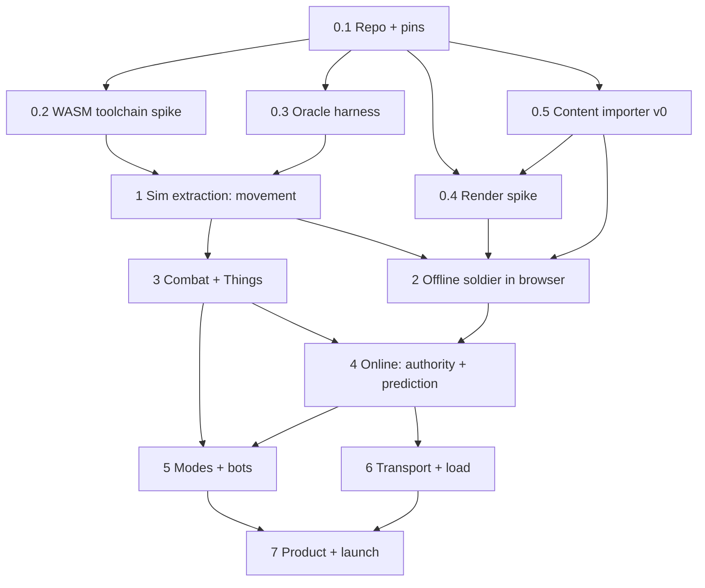

# soldat-web — Historical gated implementation roadmap

## How to read this roadmap now

This is the original phase/gate plan, preserved as design and acceptance history, **not a live missing-feature checklist**. Use [current porting status](docs/porting-status.md) for the implementation inventory, deliberate browser adaptations, remaining work and release qualification priorities; use [SPEC](SPEC.md) for the current contract.

Later work has implemented all seven modes and round transitions, waypoint bots in the server and both client replicas, balancing, console/binds/taunts, spectator controls, gestures, authenticated moderation/votes/radio/voice, and the browser menu/friend-lobby/practice flows. In particular, the original DM/CTF-only Phase 5, server-only AI and Phase 4 snapshot-delta design below describe the historical plan: current play uses ABI6, wire7 and confirmed command/input relay. Their appearance below must not be read as absent implementation or as the current protocol.

Gate criteria and receipts remain intact. A receipt proves only its named artifact, corpus, runtime and conditions; implementation or a newer targeted check does not retroactively pass an old gate. The retained G4 report explicitly does not pass its historical gate, and current adverse-network/capacity/platform release acceptance remains separate. The “First actions” section is also historical, not an instruction to recreate the repository.

## Original roadmap

Implements `SPEC.md` (requirement IDs R-*, acceptance §6, decisions D*). Each phase ends in a **gate**: a pass/fail check with recorded evidence in `docs/gates/<gate>.md`. A failed gate stops dependent work and triggers the listed fallback; nothing downstream proceeds on an assumed pass.

Sizes (S/M/L/XL) are relative effort, not calendar estimates; no duration has been measured.

Lanes after Phase 0: **sim** (Pascal: 1, 3, bots), **client** (render/input/audio: 2, HUD), **net** (protocol/server: 4, 6). They meet at the Phase 2 and Phase 4 gates.

---

## Phase 0 — Foundations and de-risking spikes

Purpose: turn the four largest unknowns (WASM toolchain, oracle traces, Phaser map rendering, content import) into measured facts before committing to Phase 1+.

### 0.1 Repository and pins — S
- Init git, Bun workspaces, layout per SPEC §7; `reference/` gitignored.
- Vendor `opensoldat/opensoldat` @`bf43a43` into `sim/opensoldat` in the first commit, excluding `shared/libs/KrakenSDK`; sim changes are reviewed as diffs against that commit. (A GitHub fork can be created later for upstreaming.)
- Record pins (SPEC §3) in `pins.json`; CI fails if any differs.
- Linux CI runner with Docker.
- Local toolchain is native macOS arm64 (`sim/build/setup-toolchain-macos.sh` → gitignored `sim/build/.toolchain`, user decision after the Docker VM filled); the Docker image `soldat-web/fpc:bcd7288` is the Linux/CI recipe and hosts the oracle. T1 comparisons (oracle vs `sim-native`) run in that image so compiler and host match.

### 0.2 WASM toolchain spike — M — gate **G0.2**
- Dockerfile building FPC trunk `bcd72886…` for `wasm32-wasip1` and native (linux amd64 + arm64), following `humanova/soldat-web/tools/setup-fpc.sh`; drop the Clang/linker patch unless required.
- Compile `Vector`, `Calc`, `Parts` (with a stub VFS) as a `library` exporting a toy `step` that integrates 10 particles for 10,000 ticks and returns a state hash.
- Host from Node 24 and from a page in Chrome, Firefox, Safari 26.4.
- **G0.2 pass:** identical hash on all four runtimes; native build hash recorded (equality with wasm not required yet); build reproducible from clean container. **Fail →** try FPC 3.3.1 official wasm32-wasip1 snapshot; if still failing, escalate D1 back to the user (TS hand-port with the oracle becomes the alternative).

### 0.3 Oracle harness — M — gate **G0.3**
- `tools/oracle`: pinned upstream + minimal patch (no mechanics edits): headless server, scripts/RCON/Steam off, fixed `RandSeed`, command-injection unit that feeds `TControl` per tick from a fixture file, tick-state dump (f32 bit patterns + decimal) after each `UpdateFrame` stage.
- Build in the 0.2 container with the same compiler, native.
- Fixture format (`tests/fixtures/*.fixture.json`): map, content-set hash, seed, players, per-tick inputs, ticks.
- First fixture: Arena, one soldier, run right 120 ticks, jump, jet until empty.
- **G0.3 pass:** two runs produce byte-identical traces; trace shows expected jet capacity `119·190 div 100 = 226`. **Fail →** fix build on Linux amd64 only; macOS native is not required.

### 0.4 Render spike — M — gate **G0.4**
- Throwaway-quality Phaser 4.2.1 scene (kept as reference, not production code): custom render node + shader per SPEC §4.3; terrain with NPOT `REPEAT`; smooth edges; three scenery layers; world-anchored gradient.
- Maps: Airpirates, Aero, DesertWind, Jungle, one heavy-scenery map; synthetic RGBA/UV triangle.
- One animated gostek from POA via a temporary TS pose evaluator (replaced by sim output in Phase 2), all parts from the exported gostek table.
- Capture matching screenshots from the native OpenSoldat client (built in the 0.2 container or a desktop build) at fixed camera.
- Stress: 903 tris + 500 props + 32 gosteks + 512 sparks; measure frame time on the named reference desktop and laptop.
- **G0.4 pass:** no Phaser source patches; SPEC §6.3 thresholds met on the fixtures; performance targets met; context loss/restore works. **Fail →** port the same node/shader/data to PixiJS v8 and re-run; choose by adapter size and measurements; update D5.

### 0.5 Content importer v0 — M — gate **G0.5**
- `packages/content`: PMS v11, POA, PO, `mod.ini`, `weapons.ini`, ZIP readers; path resolution; signature sniffing; green key + premultiply; `jump.wav` → PCM; manifests with provenance; deterministic output.
- Export `GostekGraphics.inc` table to data (MIT notice retained).
- **G0.5 pass:** 99/99 maps, 51/51 POA, 6/6 PO parse; 97 classic maps with zero missing active assets; Aftermath/Amnesia report exactly their missing terrain; two runs byte-identical; counts match `docs/research/FileFormats.md`.

---

## Phase 1 — Sim extraction: movement — XL — gate **G1**

Work in `sim/opensoldat`; every commit keeps T1 green for the corpus fixtures it covers.

1. Build skeleton: `SIM` define, new `SimMain` library unit, ABI exports from SPEC §4.1 (stubs return errors until implemented, never fake success).
2. VFS shim replacing PhysFS for `MapFile`, `Anims`, `Parts`, `SharedConfig`.
3. Role collapse, unit by unit (`Game` subset → `Parts`/`Anims`/`PolyMap`/`MapFile` → `Sprites`/`Control` movement paths): keep server-role branches; replace network/audio/UI/SDL calls with event emission; log every gameplay-relevant client-role branch in `docs/role-divergence-ledger.md` with decision.
4. Input path: `sim_set_input` writes `TControl` + press-order bits; remove SDL/mouse/camera reads from `Control`.
5. Explicit `sim_save_state`/`sim_load_state`/`sim_hash_state` over all gameplay globals touched so far (versioned layout; add fields as units come in).
6. `sim_render_view` fixed struct; `packages/sim-host` typed views over it.
7. Native target `sim-native` CLI that runs fixtures and emits traces in the oracle format; `packages/sim-host` trace diff tool (first divergent tick, field, f32 bits).
8. Movement corpus fixtures (SPEC §6.2) authored and captured from the oracle.

**G1 pass:** T1 bit-identical on the full movement corpus; T2 met for `sim.wasm`; T3 hash-identical on Node/Chrome/Firefox/Safari including save/load round-trip at every 50th tick. Ledger reviewed.

---

## Phase 2 — Offline soldier in the browser — L — gate **G2**

1. Production `SoldatMap` node and gostek renderer from G0.4, now fed by `sim_render_view` (delete the temporary TS pose evaluator).
2. Client loop: fixed 60 Hz accumulator driving `sim_step`, render interpolation fraction, `fx_step` for sparks/weather.
3. Input sampling → `TControl` with original default bindings and mouse→world aim; camera follow/zoom per SPEC §4.3.
4. SFX from sim events through Phaser Sound with original attenuation.
5. Map selector over all imported maps; local single-player sandbox.

**G2 pass:** every movement-corpus fixture replayed in the browser produces the oracle trace hash (rendering on, at 60/120/144 Hz display); rendering fixtures still within §6.3; manual side-by-side session against native OpenSoldat on Arena and Airpirates recorded.

---

## Phase 3 — Combat and Things — XL — gate **G3**

1. Extract `Weapons`, `Bullets`, weapon INI loading, firing/reload/bink/recoil (as ledgered), grenades, cluster, LAW, flamer, melee, bows.
2. Extract `Things`: kits, dropped weapons, flags, parachute, stationary gun; pickups; flag throw/return/capture.
3. Damage, death, ragdoll, respawn.
4. `RNG_POLICY=keyed` implemented alongside `original`; ledger entry.
5. Client: bullets/things rendering, sparks/explosions, HUD (R-CLI-3), kill feed.
6. Combat corpus fixtures (SPEC §6.2) captured from the oracle.

**G3 pass:** T1 (`original` policy) on combat corpus; T2/T3 on combat corpus under both RNG policies; save/load covers all new state (T3 round-trip).

---

## Phase 4 — Online: authority, prediction, interpolation — XL — gate **G4**

1. `packages/protocol`: versioned binary codec; message set from SPEC §4.4; fuzz tests on decoder.
2. `packages/server`: Node 24, `worker_thread` per match, one `sim.wasm` instance, accumulator loop with catch-up cap, input buffers, validation, reliable events with IDs, snapshot delta encoding against acked baseline.
3. Client prediction: load server state, replay unacked inputs with `REPLAY`, 128-frame ring, resync on overflow; visual correction smoothing.
4. Remote interpolation buffer (50 ms start, adaptive 33–100 ms); local/remote render split.
5. Projectile lag compensation (history 500 ms, cap 200 ms) with per-style policy.
6. Debug overlay: RTT, loss, correction magnitude, snapshot age, client-vs-server state hash on same tick.
7. Network test rig: Linux `tc/netem` on real packets, scripted headless clients (Node, sim-host) + real browser clients.

**G4 pass:** two humans play Arena online; SPEC §6.4 LAN and 100 ms/1 % gates pass at 2 and 8 players; security checks pass; debug hash compare shows zero divergence on acked ticks.

---

## Phase 5 — Game modes and bots — L — gate **G5**

1. DM and CTF match flow: join/leave/team selection, respawn timers, scoring, time/score limits, map rotation, scoreboard (R-SIM-7).
2. Extract `AI.pas` + `Waypoints` into the sim behind `AI_ENABLED`, AI RNG stream; server-only; bot fill setting.
3. Offline practice with bots (R-CLI-5).
4. Manifest flags for bot-capable maps (waypoint count > 0).

**G5 pass:** 30-minute 8-bot CTF and DM matches on every bot-capable stock map without crash, stuck bots counted and reported; bot behaviour reviewed side-by-side against native OpenSoldat bots on 3 maps; T3 still green with AI disabled on clients.

---

## Phase 6 — Transport and capacity — L — gate **G6**

1. WebTransport adapter (Node `@fails-components/webtransport` first) mapping `latestState` to datagrams, `reliableControl` to a stream; WSS stays the fallback, chosen at admission.
2. Full SPEC §6.4 matrix for WSS vs WebTransport on Chrome, Firefox, Safari 26.4.
3. Load: 16 players (bots + scripted clients) per match; matches per VM; 30-min and 2-h soaks; GC/event-loop tails.
4. Optional: same load trace on Bun; switch only on measured advantage (D7).

**G6 pass:** server targets in §6.4 at 16 players; promote WebTransport only if p99 snapshot/input age under 1–3 % loss improves materially with acceptable connection success; otherwise ship WSS and record the evidence. WebRTC is evaluated only if WebTransport fails interop.

---

## Phase 7 — Product and launch — L — gate **G7 (release)**

1. React shell: main menu, server list, join links, settings (graphics filtering/mipmaps/dither, audio, key binds), nickname.
2. Credits & Licenses screen + served third-party notices (SPEC §9.3); provenance manifest shipped with bundles.
3. Local-only `.pms`/`.smod` import with untrusted-archive limits (R-CON-5).
4. Public name/logo cleared; disclaimer on landing page and About.
5. Deploy: CDN for client + content bundles; regional Linux VMs (WSS 443, UDP 443 if WT promoted); metrics/alerts (R-SRV-3); crash reporting.
6. Closed playtest with veteran players on 5 stock maps; feedback triaged into ledger entries vs bugs.

**G7 pass:** all prior gates still green in CI on the release build; SPEC §6.5 audio/content checks on all target browsers; licensing checklist complete; playtest blockers closed.

---

## First actions (in order)

1. 0.1 repo + fork + pins.
2. In parallel: 0.2 toolchain spike, 0.3 oracle harness, 0.5 importer v0.
3. 0.4 render spike once 0.5 emits the gostek table and map data.
4. Outreach (no dependency on replies): humanova (toolchain, VFS shim, sim-extraction interest), OpenSoldat Discord (oracle harness and `SIM` define as upstreamable work).
