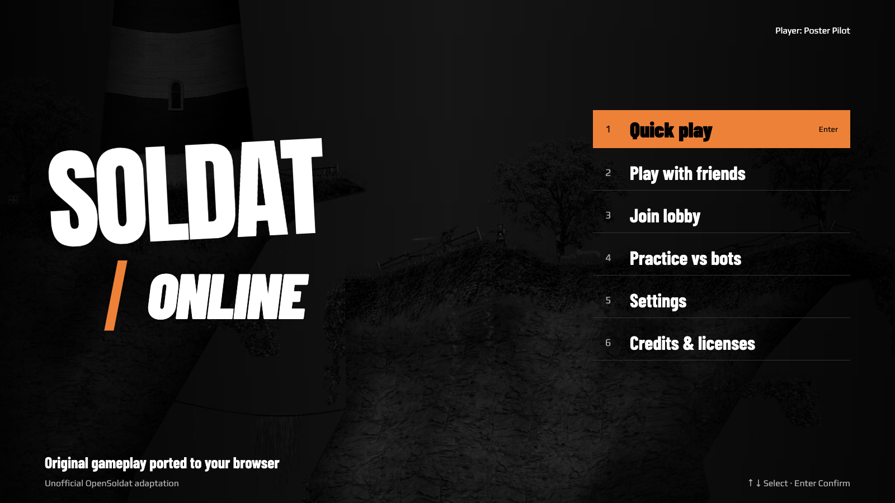

# soldat-web

**Soldat Online** is a browser adaptation of pinned OpenSoldat 1.8: original Pascal gameplay compiled to WebAssembly, a React/Phaser client, and a Node 24 authoritative multiplayer server. It is not compatible with native Soldat/OpenSoldat network servers.



**Development/private builds only.** Written THD/MM permission for the Soldat name and related branding is still a public-launch prerequisite. This is an unofficial project, not affiliated with or endorsed by Transhuman Design.

## Start here

- [Development setup and focused checks](docs/development.md): pinned sources/toolchain, native/WASM build, content import, local HTTPS/WSS and Vite.
- [Current porting status](docs/porting-status.md): implemented scope, remaining unported items, qualification gaps and explicit non-goals.
- [Contributing](CONTRIBUTING.md): mechanics, authority, compatibility, evidence and licensing rules.
- [Specification](SPEC.md): decisions and fidelity requirements.
- [Delivery and release roadmap](PLAN.md): current priorities, remaining product gaps and release exit criteria.
- [Deployment guide](deploy/README.md): direct-TLS region operation; reconcile any recorded artifact hashes with the current qualified release before deploying.

After completing the [one-time setup](docs/development.md#prepare-a-checkout), start these in separate terminals from the repository root:

```sh
bun run --cwd packages/server dev
```

Trust the local certificate by visiting `https://127.0.0.1:7443/api/ping`, then:

```sh
VITE_SERVER_URL=wss://127.0.0.1:7443 bun run --cwd packages/client dev --port 5195
```

Open `http://127.0.0.1:5195/`. The server launcher and client build **consume** `build-out/sim/sim.wasm` and `dist/content-next`; neither builds the Pascal simulation nor imports content for you.

## Architecture

| Area | Responsibility |
| --- | --- |
| `sim/opensoldat/` | Reduced, maintained Pascal simulation core under `sim/` and `shared/`, with extraction/mechanics changes and retained upstream notices; source of the native and WASM simulation. |
| `packages/sim-host/` | Host ABI, verified content mounting, render/state views and fixture runners. |
| [`packages/client/`](packages/client/README.md) | React menus/settings; Phaser canvas, input, audio and presentation; confirmed and predicted WASM replicas online. |
| [`packages/server/`](packages/server/README.md) | Node **24** HTTPS/WSS admission, lobbies, typed administration and authoritative match workers; one match/WASM instance per worker. |
| [`packages/protocol/`](packages/protocol/README.md) | Shared bounded binary codec and transport contracts; currently wire **7**, independently of simulation ABI/state **6** (`0x00010006`). |
| [`packages/content/`](packages/content/README.md) | Bun importer: pinned base assets → hash-addressed browser derivatives, provenance and verified raw simulation packs. |
| `tools/`, `tests/fixtures/`, `docs/gates/` | Native oracle/render reference, deterministic fixtures and artifact-specific qualification records. |
| `reference/opensoldat/`, `reference/base/` | Optional pristine upstream submodules, registered as gitlinks at the `pins.json` commits; comparison/import inputs, never the editable product core or shipped browser source. |

Pascal owns fixed-step gameplay, bots, poses used for hits, weapons and round state. TypeScript hosts the simulation and submits intent; rendering and prediction never confer gameplay authority. Default population is **12 humans plus bots in total**, with **32 maximum slots**. Current scope includes seven modes, stock weapons/bots, rounds/rotations, alternate rules, shell/settings, authenticated chat/moderation/votes/radio and opt-in voice. Implementation is not blanket parity or launch qualification: consult the [status ledger](docs/porting-status.md).

Prepared-artifact client/server work can omit both upstream submodules when the required WASM and full imported content are already available. Content import, oracle and native-reference workflows need the pinned references; see [optional initialization and pin checks](docs/development.md#pinned-upstream-checkouts-and-dependencies). Rebuilding the simulation still requires the maintained Pascal core and pinned/patched compiler. Pruning unused native client/server and third-party source from the maintained tree does not reduce the shipped browser payload or remove future porting material: the pristine upstream source remains available through the submodules, with historical research and receipts retained.

## Evidence and rights

`pins.json` and `bun.lock` fix source/dependency baselines. Historical gate reports, research and package verification notes qualify only their recorded WASM/content/runtime/fixture combinations; an old pass does not qualify a rebuilt binary. `PLAN.md` tracks the remaining delivery and release work, not completed bootstrap instructions. There is no root test/build aggregator or enforced CI release gate today; use the [serial check layers](docs/development.md#run-checks-in-layers).

Default `bun run check:pins` validates exact staged upstream gitlink pins and initialized references' own HEADs and cleanliness, allowing absent optional references. Dirty references fail without modification. Use `bun scripts/check-pins.ts --require-references` when the workflow requires both upstream checkouts; pin checks do not qualify the compiler or built WASM.

Project/OpenSoldat code is MIT except retained per-file exceptions such as `Vector.pas` (MPL 1.1). Pinned base content is CC BY 4.0; Play, Anton and Barlow Condensed fonts carry OFL notices. Preserve upstream notices, transformation provenance and credits; do not redistribute classic-installer assets or the excluded Kraken SDK. See [SPEC §9](SPEC.md#9-content-licensing-branding) and [contribution policy](CONTRIBUTING.md#licensing-and-release-boundaries).
