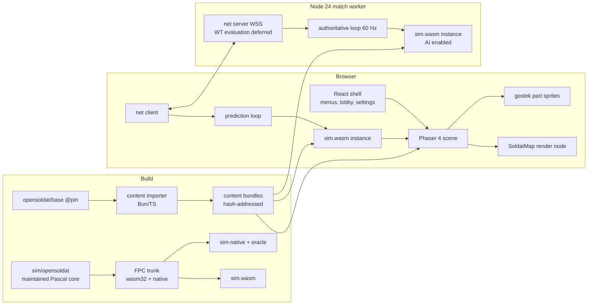

# soldat-web — Specification

Status: scope updated 2026-10-18 for seven-mode gameplay, balancing, console/taunts, spectator controls, native actions, moderation/communications and the browser menu. This is the product contract, not a completed-port claim. See [current porting status](docs/porting-status.md) for missing capabilities and qualification gaps; historical gate results qualify their recorded artifacts only.
Evidence: `docs/research/*.md` (six research reports; each claim there carries a source-line or URL citation). Product requirements and decisions are recorded here; raw private conversations are not retained.

Document authority: this specification defines requirements and thresholds; [PLAN](PLAN.md) defines delivery order; [porting status](docs/porting-status.md) records implementation and qualification gaps; [development](docs/development.md) provides current commands. Dated research proposals and gate results do not override the current decisions below or establish release acceptance for another artifact.

## 0. Decision log

| # | Decision | Source |
|---|---|---|
| D1 | Simulation core = **original OpenSoldat Pascal mechanics, extracted and compiled to WebAssembly**, hosted from TypeScript in both browser and server. No hand-port to TS. | User, after prior-art findings |
| D2 | Fidelity baseline = **OpenSoldat 1.8 source as-is**, pinned to `opensoldat@bf43a43bdd7a069e02c906768807f66e621b2888`. Classic 1.7.1.1 is informational only. | User |
| D3 | **Strict server authority**: clients submit inputs and bounded weapon/team/appearance intent; the server owns movement, projectiles, hits, ammo, health, pickups, scoring and round transitions. Clients predict locally. | User |
| D4 | Gameplay scope = **DM, PM, TM, CTF, Rambo, INF and HTF**, stock weapons/waypoint bots, rounds/rotations, alternate rules, bonuses, team changes/balancing and appearance. Includes console/binds/taunts, spectator controls, native gestures, authenticated live moderation, map/kick voting, native team radio and opt-in push-to-talk voice. Default total population remains **12**. | User, expanded 2026-10-17 |
| D5 | Renderer = **Phaser 4.2.1 + custom Soldat map render node**, conditional on spike gate G0.4; fallback PixiJS v8 with the same shader. | Product preference + RenderingPhaser |
| D6 | Gameplay transport = **WSS first** (binary, versioned); evaluate WebTransport before gameplay WebRTC. Voice separately uses opt-in WebRTC audio with authenticated WSS signaling and operator-configured ICE/TURN. No gameplay authority moves to peers. | Default (NetcodeTransport), voice expanded by user |
| D7 | Server runtime **Node 24 LTS**; one WASM instance per match, one match per `worker_thread`. Bun for tooling/build only. | Default |
| D8 | Content = **opensoldat/base pinned at `5b6e5bef23f5c0d58fb1d4d887b9b94ebcf799b4`** (CC BY 4.0), curated and hash-manifested. No files from the classic 1.7.1.1 installer are shipped. | Default (LicensingProvenance) |
| D9 | Platforms: desktop, keyboard + mouse; current and previous major of Chrome/Edge, Firefox, Safari ≥ 26.4. Mobile/touch out of scope. | Default |
| D10 | Product name **"Soldat Online"** (user decision 2026-10-16). Public deployment is authorized; the user removed the self-imposed private-build/written-branding-permission gate on 2026-10-18. Keep accurate attribution and the unofficial/non-endorsement disclaimer; do not claim official status or verified branding clearance. | User |

Defaults D5–D10 are reversible; changing them changes the plan, not the architecture.

## 1. Goal

A browser-native, online multiplayer game that **plays identically to OpenSoldat 1.8** for movement, weapons, collision and bots, renders original Soldat maps and soldiers faithfully, and runs on modern authoritative-server netcode.

### 1.1 Non-goals (launch)

- Native gameplay/lobby protocol compatibility with existing Soldat/OpenSoldat servers or clients.
- Demo recording/playback and the original TCP RCON administration service. Browser administration uses authenticated typed WSS requests, never arbitrary OS commands.
- PascalScript server scripts, Kraken anti-cheat, custom HUD (`.sif`/`.sint`) layouts, pre-1.7.1 weapon mods, pre-v11 `.pms`/`.pmp` maps.
- In-game music (OpenSoldat 1.8 does not reference the three tracker modules).
- Accounts, rankings and progression persistence (no PostgreSQL at launch), public user map hosting. Optional operator address-ban persistence is local JSON.
- Mobile/touch controls, WebGPU.

## 2. Assumptions register

Initial design assumptions and what research established. "Consequence" is binding on this spec.

| Initial assumption | Verdict | Consequence |
|---|---|---|
| Nobody has done a browser Soldat; we must port | **Refuted.** `humanova/soldat-web` (MIT, Sep 2026) runs the original Pascal client as WASM. It is a client + UDP relay, no sim API, no authoritative server. | D1. Reuse its FPC wasm32 toolchain recipe and VFS ideas with attribution; do not fork its client. |
| A TS port of the sim is the natural path | **Weakened.** ~17k LOC mechanics surface; 503 `{$IFDEF SERVER}` branches in mechanics units; f32/ties-even rounding, RNG order, `Math.sin` engine variance all threaten fidelity. | D1. WASM preserves arithmetic, and the same binary gives cross-engine determinism. |
| Source code is the spec for "original feel" | **Nuanced.** Source is unfinished 1.8, not 1.7.1.1; later commits changed mechanics. | D2: pin 1.8 commit; source is truth by definition. |
| Fixed-rate sim independent of rendering | **Confirmed.** 60 Hz, `TimeStep=1`, forces in tick units. | Sim never sees wall-clock dt. |
| Character animation is presentation | **Refuted.** POA poses drive hit circles, muzzle, grenade release, flag anchor. Server needs POA/PO. | Pose evaluation lives in the sim; renderer only interpolates sim skeletons. |
| Maps = geometry + textures | **Refuted.** 26 polytypes, stateful background transitions, bounciness encoded in raw normal magnitude, sectors, colliders, waypoints, `StartJet` conversion. | Sim parses raw `.pms` bytes itself; nothing normalizes normals. |
| Phaser renders original maps out of the box | **Refuted.** Phaser 4.2 `Mesh2D` has no per-vertex RGBA; tint math differs from Soldat's vertex-premultiplied alpha; Phaser refuses NPOT `REPEAT` (desert terrain is 1536×512). | D5: custom render node + shader; spike gate G0.4. |
| Rendering is 640×480 | **Nuanced.** Logical height 480, width = round(clamp(aspect,1.25,1.78)·480), exp-zoom camera with 0.14 follow and aim offset. | §5.3 camera requirements. |
| Server decides damage (original did client hits) | **Mostly source-aligned.** Original server computes damage but **trusts client position/velocity** and never corrects own position. | D3 is a deliberate feel change; reconciliation must be tuned and measured (§6.4). |
| Original send rate ≈ tick rate | **Refuted.** 60 Hz sim, ~12–15 Hz client movement sends, slower snapshots. | New protocol: 60 Hz inputs, 30 Hz snapshots (initial). |
| WebSockets now, WebRTC later | **Updated.** Safari 26.4 shipped WebTransport (Mar 2026). | D6. |
| Original assets are CC BY / MIT | **Nuanced.** Base assets CC BY 4.0 (since Jul 2020); font is SIL OFL 1.1; `Vector.pas` is MPL 1.1/LGPL; Kraken SDK is revocable-permission only; classic installer is shareware-licensed. | §9 content/legal policy. |
| Base assets = classic assets | **Partly.** All 97 classic maps byte-identical; some sprites/scenery/kits changed; 1.7.x art is already HD. | D2 makes base + OpenSoldat rendering the visual truth. |
| `.smod` is a custom format | **Refuted.** Standard ZIP; PhysFS mount precedence matters. | Importer reads ZIP; mount rules ported. |
| Images load directly | **Nuanced.** 2,070 PNG-override lookups, 12 case-only matches, 16 extension/signature mismatches, exact green key (0,255,0,255) on single-frame images only, 921/1,066 NPOT, ~375 MiB decoded total. | §5.2 importer rules; per-map lazy loading. |
| Sounds need conversion | **Narrow.** 163 PCM WAV + 1 MS-ADPCM (`jump.wav`). | Decode masters (incl. `jump.wav`), ship Ogg Opus (user decision 2026-10-16). |
| Bots needed for early testing | **Refuted.** Scripted command fixtures isolate physics better. | Bots are implemented; original AI and full-stock bot behavior have a separate qualification lane. |

## 3. Pinned baselines

| Item | Pin |
|---|---|
| OpenSoldat source | `bf43a43bdd7a069e02c906768807f66e621b2888` (develop, 2026-09-26) |
| Base content | `5b6e5bef23f5c0d58fb1d4d887b9b94ebcf799b4` |
| FPC (wasm32-wasip1 and native) | trunk `bcd728860dcd953cb6f3bbda788eab07b0d16c85` (humanova recipe); same compiler for oracle, native-extracted and wasm builds |
| Phaser | 4.2.1 |
| Node | 24 LTS |
| Weapons | `base/server/configs/weapons.ini` (Version=1.7.1 units) |

The source and base pins are recorded both in `pins.json` and in tracked gitlinks for the optional pristine `reference/opensoldat` and `reference/base` submodules. [Development setup](docs/development.md#pinned-upstream-checkouts-and-dependencies) initializes only those paths, without fetching nested dependencies. Default `bun run check:pins` validates exact staged gitlinks against `pins.json` and initialized references' own HEADs and working-tree cleanliness while permitting absent optional references. Dirty references, including non-ignored untracked files, fail without modification; empty/uninitialized paths cannot resolve to the superproject's HEAD. `bun scripts/check-pins.ts --require-references` requires both for import/oracle/native-reference workflows; unknown flags are rejected. Prepared-WASM/content app work can omit the references, not the maintained Pascal source when rebuilding.

## 4. Architecture



### 4.1 Simulation core (`sim.wasm`)

**Source.** A reduced, maintained extraction of `opensoldat/opensoldat` at the pinned commit lives in `sim/opensoldat/{sim,shared}`, with reviewable extraction/mechanics changes and required license/author notices. The original full vendor import is historical; unused native client/server and third-party code is no longer maintained in that tree. The optional pristine `reference/opensoldat` submodule preserves upstream comparison and future porting material; `reference/base` supplies pinned import content. Neither is a replacement for the patched core during simulation rebuilds. Source pruning does not change the shipped browser payload, erase historical receipts, or authorize redistribution of excluded KrakenSDK/native dependencies. Units in scope: `Vector, Calc, Parts, Anims, PolyMap, MapFile, Waypoints, Weapons, SharedConfig (weapon INI subset), Game (state subset), Sprites, Control, Bullets, Things, AI, Sparks`.

**Role.** Compiled once with a single role-neutral define (`SIM`). Gameplay semantics follow the **server-role** branches. Every client-role branch that changes gameplay (self-bink, recoil-to-cursor, client jet-fuel 1→0 adjustment, client-only bullet history collision, push-tick scheduling) is recorded in `docs/role-divergence-ledger.md` with an explicit decision. Network, audio, menu, SDL, script and Steam calls are removed or replaced by event emission.

**Platform shims.** PhysFS replaced by an in-memory VFS populated by the host (`sim_vfs_put`). No C objects, FreeType, SDL or OpenAL in the sim. [INFERENCE: this may remove the need for humanova's Clang/linker patch; verify in G0.2.]

**ABI (C calling convention, numeric args, linear-memory buffers).** The table below is the initial architectural contract, not the current binary layout. The implemented ABI/state/render/FX version is `0x00010006`; use [the ABI reference](docs/formats/sim-abi.md) and `packages/sim-host/src/sim.ts` for exact exports and schemas.

| Export | Purpose |
|---|---|
| `sim_version() → u32` | ABI + state-layout version |
| `sim_alloc(n)` / `sim_free(p)` | host buffers |
| `sim_vfs_put(path, len, data, len)` | provide content files before init |
| `sim_init(rules, len, seed_lo, seed_hi, flags)` | flags: `AI_ENABLED`, `RNG_POLICY` |
| `sim_load_map(name, len) → status` | parse `.pms` via original `MapFile`/`PolyMap` |
| `sim_command(tick, ptr, len)` | reliable commands: join, leave, team, weapon choice, respawn, kick |
| `sim_set_input(slot, tick, ptr)` | per-tick input (below) |
| `sim_step(flags) → tick` | advance one 60 Hz tick; flag `REPLAY` suppresses FX/sound events |
| `sim_events(out, cap) → len` | drain ordered gameplay + presentation events |
| `sim_render_view() → ptr` | fixed-layout struct readable as typed arrays: per sprite current+previous 24 skeleton points, anim IDs/frames, aim, weapon, flags; bullets; things |
| `sim_save_state(out, cap) → len` / `sim_load_state(p, len)` | versioned explicit serialization of all gameplay globals incl. RNG state |
| `sim_hash_state() → u64` | gameplay state hash |
| `fx_step()` / `fx_render_view() → ptr` | cosmetic sparks/weather subsystem: own RNG, excluded from save/load/hash, never stepped during replay |

**Input record** mirrors the original `TControl` (`Sprites.pas:79-84`): booleans `Left, Right, Up, Down, Fire, Jetpack, ThrowNade, ChangeWeapon, ThrowWeapon, Reload, Prone, FlagThrow` (packed to u16), `MouseAimX, MouseAimY, MouseDist` (i16, world-space, as the original), plus the press-order bits needed for the original first-key/conflicting-key resolution (`Control.pas:64-70,175-180`).

**RNG.** `RNG_POLICY=original` keeps FPC `Random` with global consumption order — used only for T1 oracle comparison. `RNG_POLICY=keyed` (product) derives spread/cluster/damage-poly randomness from `hash(match_seed, entity, counter)` so predicted shots match the server regardless of other players' consumption; AI uses its own stream. Both are ledger entries.

**Instancing.** All sim state is Pascal globals ⇒ exactly one match per WASM instance. Never share an instance across matches.

### 4.2 Content pipeline (`packages/content`)

- Input: pinned base checkout (and, later, user-supplied local `.smod`/`.pms`).
- TS readers for PMS v11, POA, PO, `mod.ini`, `weapons.ini`, ZIP; byte layouts per `docs/research/FileFormats.md` §1. Strict bounds/finite checks; accept and preserve trailing bytes.
- Path resolution exactly as `GameRendering.pas:337-354`: lowercase + `/` canonical ID, PNG preferred over requested extension, case-insensitive match; image type from signature, not extension.
- Images: exact green key (0,255,0,255) only on single-frame non-terrain images; derivatives stored straight-alpha and premultiplied exactly once at GPU upload; NPOT preserved; per-asset scale from `mod.ini` `[SCALE]` (default 4.5); `GostekGraphics.inc` 131-entry table (IDs 0–130; the file is 138 lines) exported as data with `[GOSTEK]` center overrides. Shipped derivatives are lossless WebP whose decoded RGBA is byte-identical to the keyed PNG derivative.
- Audio: shipped as Ogg Opus (user decision 2026-10-16, lossy; WAV masters stay importer input only, `jump.wav` decoded from MS-ADPCM first); loaded on demand with a per-match preload set.
- Delivery: one small content index per session, per-map manifests on selection, one verified sim-content pack per match, `sim.wasm` compiled once per session; hash-named files served `immutable` and precompressed.
- Output: immutable hash-addressed objects + per-map manifest (`map hash, terrain, scenery, sim content set`) + a **sim content set** (raw PMS, POA, PO, weapons.ini) with one combined hash that client and server must match before join.
- Provenance per file: source repo/commit/path, SHA-256, license id, credit, transformations.
- Missing active dependencies are reported and rendered with the original fallback (`default` texture) plus a visible warning.

### 4.3 Client (`packages/client`)

- Vite + React 19 browser shell: loading/nickname, quick play with region probing and cancellable countdown, friend-lobby create/join/readiness/host controls and invite links, compatible map selection, seven-mode bot practice, categorized settings, appearance, credits/licenses and in-game pause navigation. React never touches per-frame state. This is a browser adaptation, not the native launcher or a filterable public server-list UI; the latter remains a scope gap (R-SRV-1).
- Phaser 4.2.1 scene owns the canvas, input sampling, audio (Web Audio via Phaser Sound) and draw.
- `SoldatMap` render node: vertex `(x,y,u,v,RGBA8)` 20 bytes, static buffers, vertex shader `color = vec4(rgb*a, a)`, fragment `texture(PMA) * color`, blend `ONE, ONE_MINUS_SRC_ALPHA`, terrain `REPEAT` incl. NPOT (WebGL2 native or repeat-aware shader), original polygon order within layer, consecutive same-texture runs batched.
- Draw order exactly `GameRendering.pas:1004-1086`: gradient (world-anchored) → background edges → background polys → scenery L0 → bullets → soldiers → things → sparks → scenery L1 → thing polys → foreground edges → foreground polys → scenery L2 → HUD.
- Smooth edges generated as in `MapGraphics.pas:460-492,617-671`.
- Gostek: one sprite per visible part from the exported table: position = skeleton p1, rotation = atan2(p2−p1), pivot, flex stretch `min(1.5, |p2−p1|/Flex)`, flip rule per part, team texture variant, per-channel colors, +1 Y offset.
- Render interpolation: lerp previous/current sim skeletons by accumulator fraction; never mutate sim state.
- Camera: logical height 480; width from clamped aspect; zoom `exp(z)` eased by ¼ per tick, snap 0.01; follow 0.14 + aim offset per `UpdateFrame.pas:351-400`; mouse→world round-trips exactly.
- Filtering: nearest/linear and mipmaps configurable per class as original; no global pixel-art switch; no additive blending.

### 4.4 Server and netcode (`packages/server`, `packages/protocol`)

- Match worker: monotonic accumulator, fixed native steps at 60 Hz normally and 20 Hz during original bullet time; max 4 catch-up ticks per wake, overload recorded; never variable simulation dt.
- Messages: explicit versioned little-endian binary codec. Asset delivery via CDN, never over the game socket.
- Client→server: input frame every tick `{seq, tick, input}` + previous 2 frames (redundancy). Server buffers per player and accepts inputs up to 8 ticks (133 ms) ahead of its current tick — early inputs are only queued, consumed at their tick, and buy no simulation time; the client targets a small positive buffer (adaptive jitter margin ≤ 6 ticks, leaving 2 for clock error). Server repeats last input on gap and rejects stale one-shot actions.
- Server→client (protocol v7, retaining v4 input relay, v5 gameplay/round bootstrap and v6 chat/notices, adding typed gestures, moderation, votes, radio and voice signaling): the server streams its **confirmed timeline** as ordered records, flushed every 2 ticks (30 Hz normally, 10 Hz during bullet time). Historical v3 full-state deltas measured 0.5 MB/s per client at 8 players and 2 MB/s at 32:
  - `step {tick, commands[], inputs[]}` — membership/weapon `sim_command` JSON bytes the server applied before stepping `tick`, then the consumed 12-byte input of every **human** slot. Bots are never on the wire: every client instance runs original AI from the same state (verified bit-identical vs the AI-on server for 10,000 ticks on ctf_Ash 8 bots, Arena 8, ctf_Laos 31). Within one message the first `step` carries every human input; later steps carry only inputs that changed.
  - `correct {tick, slot, input}` — a lag-compensation rewind replaced one historical input; clients roll back to `tick` and replay.
  - `hash {tick, hash}` — `sim_hash_state` of the server's current boundary at that point of the stream, every 30 ticks and after every `correct`. Mismatch ⇒ full resync.
  - Per-recipient header: `lastConsumedInputSeq`. Join/resync send one full `sim_save_state` (`state {tick, hash, lastConsumedInputSeq, bytes}`), then the record stream from that tick; a `correct` older than a recipient's sync tick is replaced by a fresh full state for that recipient. No baselines, deltas or snapshot ACKs. Reliable gameplay events (kills, captures, pickups, score) use IDs and exactly-once application delivery. Chat and nonfatal notices are separate reliable presentation messages.
- Round boundary: native time/score limits enter results/countdown. At readiness, the server commits old-map events, loads the next compatible map without removing players and sends `welcome {roundEpoch,...}` then a full state. Ticks, event IDs and input sequences stay monotonic; old-map rewind/prediction history is discarded. Render assets prepare independently while authoritative records and timing probes continue. Late joiners bootstrap the current map/epoch.
- Optional `balanceTeams` is immutable, default false: least-populated playing-team admission, rejection of worsening switches, and bot-first balancing after departure/spectating. Spectators are excluded and FFA is unchanged. Every move uses original native `ChangeTeam` and is reproduced by all replicas; automatic departure balancing is an explicit extension to original admission-only policy.
- Public/team chat, taunts and numbered radio derive identity from admission and teams from native state; presentation does not enter simulation hashing. Only validated typed gestures, self-kill and authenticated moderator actions reach native commands. Map/kick votes run on the authority with frozen admitted-human electorates. Opt-in voice media is separate WebRTC audio; the server authorizes signaling, channel/mute policy and admission-scoped peer identities.
- Client confirmed instance: AI on, steps exactly the record stream (commands, then human inputs, then `sim_step`); keeps a state anchor every 8 confirmed ticks for rollback (save ≈ 1.6 ms, step ≈ 0.2 ms, so anchors are sparse and replays are cheap) and verifies each `hash`.
- Prediction instance: AI on (bots predicted by original AI), remote humans held at their last confirmed input; when newly confirmed ticks contain inputs/commands/corrections different from what prediction stepped, `sim_load_state(confirmed)` and replay unacknowledged local inputs with `REPLAY`; otherwise no reload. Ring of 128 frames; overflow ⇒ full resync.
- Remote soldiers render from interpolated confirmed-instance poses (start 50 ms, adapt 33–100 ms); local soldier renders from prediction; corrections smoothed visually only.
- Server rewind history keeps a saved anchor every 4 ticks plus every tick's consumed inputs; a rewind restores the nearest anchor at or before the shot tick.
- Lag compensation for projectiles: on an admissible delayed fire command, derive muzzle/aim/cooldown from historical shooter state and step the projectile through historical target states to now; history 500 ms, catch-up cap 200 ms. Grenades/rockets/melee get explicit per-style policy. The cap limits compensation, not admission: movement inputs are accepted regardless of the client's view age, and fire/grenade commands whose view is older than the cap execute at present time without rewind (counted as a metric), never dropped.
- Client prediction lead is adaptive (smoothed one-way delay + jitter margin + 1–2 ticks, bounded by the 128-frame ring), not a fixed cap.
- Validation: finite/range checks, input rate cap, sequence/replay rejection; client never sends position, velocity, hits or damage.
- Transport interface: two channels `reliableControl` and `latestState`. WSS implements both on one socket. The v7 record stream is ordered and reliable on WSS; a future datagram adapter must retain ordered recovery rather than drop tick records. Transport is chosen once at admission; no mid-match switching. WebTransport and gameplay WebRTC are not implemented transports; voice WebRTC is separate.
- Matchmaking and lobbies (user decision 2026-10-16): a server process runs a registry of matches (one worker + one WASM instance each). HTTPS API `/api/ping`, `/api/regions`, `/api/quickplay`, `/api/lobbies`, `/api/lobbies/:code`; lobby updates over WSS (same binary protocol version as matches). Quick play: client pings each configured region, auto-selects the lowest after a 3 s cancellable countdown, joins the least-loaded public match with room or creates one. Friend lobbies: 8-character Crockford base32 code / `/?lobby=CODE` link (case-insensitive, 40 bits), host sets mode then map, guests ready, host starts and may kick guests; late join allowed. Every match keeps a target player total filled with original bots: a joining human replaces a bot, a leaving human is replaced by one. Multi-region is a stretch goal (config-driven region list; dev ships one Local region).

### 4.5 Bots

Original `AI.pas` runs inside every sim instance (`AI_ENABLED`) — server, client confirmed and client prediction — using PMS waypoints and its own keyed RNG stream; the bot brain is part of save-state, so AI-on instances that start from the same state and receive the same human inputs and commands stay bit-identical. Bot controls are never transmitted. Maps with zero waypoints are flagged bot-incapable in the manifest.

## 5. Functional requirements

### 5.1 Simulation
- **R-SIM-1** 60 Hz fixed tick normally, with original tick-unit physics; optional `bulletTime` (default false) retains native activation/timer and publishes the slower host tick scale (20 Hz), rather than using variable simulation dt.
- **R-SIM-2** All movement states: run, air control, jump/sidejump (frame-gated), backflip, roll, crouch, prone, get-up, jets with `floor(119·StartJet/100)` capacity and grounded/airborne refill.
- **R-SIM-3** All 26 polytypes with source semantics, including background transitions, team/flag filters, bouncy (raw normal magnitude), deadly/hurts/lava/regenerate/explodes.
- **R-SIM-4** All 23 stock weapon definitions and 14 bullet styles, INI overrides over compiled defaults, grenade charge/release frames 15–36, cluster fragments, ricochet, arrows, flamer, LAW posture gates, melee.
- **R-SIM-5** Things: flags, kits, dropped weapons, parachute, stationary gun; pickup rules; flag throw/return (1500 ticks) /capture.
- **R-SIM-6** Death, ragdoll (skeleton Verlet), respawn via spawnpoints.
- **R-SIM-7** All seven original modes, native objectives/scoring, time/score endings, results/countdown and compatible map rotation; original alternate rules and bonus scheduler. Player identity, chosen loadout, team and appearance survive round transitions.
- **R-SIM-8** Bots per §4.5.
- **R-SIM-9** Up to 32 player slots (original `MAX_PLAYERS`); launch acceptance at 16.

### 5.2 Content
- **R-CON-1** Import all 99 base maps with zero parse failures; 97 classic maps with zero missing active assets; Aftermath/Amnesia import with explicit fallback warnings.
- **R-CON-2** All 51 POA, 6 PO, gostek table, weapons.ini, mod.ini consumed from pinned base.
- **R-CON-3** Deterministic output: same inputs ⇒ byte-identical bundle hashes.
- **R-CON-4** Per-map lazy loading; global core graphics loaded once; SFX loaded on demand with a per-match preload set.
- **R-CON-5** Local-only import of a user `.pms`/`.smod` for offline viewing (no upload). Untrusted archives: bounded entries, bytes, dimensions, no traversal, case-collision rejection.

### 5.3 Client
- **R-CLI-1** Render per §4.3 at ≥144 Hz on the reference desktop (to be named in G0.4) and ≥60 Hz on the reference laptop.
- **R-CLI-2** Original key defaults; rebinding; mouse aim.
- **R-CLI-3** HUD: health, ammo, jet, grenades, vest, weapon, reload, team/score, ping, kill feed, chat, scoreboard. Default interface only.
- **R-CLI-4** Sound: positional SFX from sim events with original attenuation semantics; explicit audio-unlock gesture.
- **R-CLI-5** Offline practice mode: local sim instance with bots, no server.
- **R-CLI-6** Credits & Licenses screen reachable from main menu and in-game About (§9).
- **R-CLI-7** Original-style console/history, persistent last-bind-wins controls, editable taunts, native Alt+1–4 gestures, public/team chat/radio and local mute. Authenticated typed moderation, map/kick votes and opt-in push-to-talk voice include permission/error feedback and secret-safe history. Browser connection commands obtain fresh admission; native network/RCON interoperability and demos remain excluded.
- **R-CLI-8** Spectator/dead-player follow/cycle/free-camera controls with original team/Realistic restrictions, neutral gameplay input, target invalidation on membership changes and conservative follow reset on full-state recovery.

### 5.4 Server/ops
- **R-SRV-1** Server list, join by link, nickname only.
- **R-SRV-2** Regional Linux VMs, WSS on TCP/443; UDP/443 reserved for WebTransport evaluation.
- **R-SRV-3** Metrics: tick lateness, step/encode time, GC/event-loop delay, per-client RTT/loss, correction magnitudes, snapshot age, bytes/s.

## 6. Acceptance criteria

### 6.1 Determinism tiers (sim)
- **T1 refactor equivalence** — `sim-native` (extracted, `RNG_POLICY=original`, AI off) vs `oracle` (pinned upstream + trace/injection harness only, server role), same compiler/host: **bit-identical f32 state every tick** across the movement and combat corpora (§6.2). Every deviation must map to a ledger entry or fails.
- **T2 target equivalence** — `sim.wasm` vs `sim-native`, same corpus: **identical tick for every discrete event** (grounding, collision branch, shot, hit, death, pickup, capture) and numeric max abs error ≤ 1e-4 world units (≤ 300 ticks) / ≤ 1e-3 (10,000 ticks). Target bit-exact; any mismatch is root-caused (likely RTL transcendental differences). Thresholds are initial and tighten as evidence allows.
- **T3 cross-runtime** — the same `sim.wasm` in Node 24, Chrome, Firefox, Safari: **identical `sim_hash_state` at every tick** over all corpora, including `save/load` round-trips mid-run. Hard requirement; prediction depends on it.

### 6.2 Fixture corpora
- Movement: mirrored flat/slope runs; acute/overlapping edges; key press orders; tap/hold jump; sidejumps/backflips; roll→crouch/prone/get-up; jets at capacity 0/1/N; refill parity; background entry/exit; every team/flag polytype; bouncy.
- Combat: standing/crouch/prone/moving targets; all 7 hit circles; thin-wall high-speed; ricochet; collider/thing/player ordering; damage decay; reload interruption; shotgun/Eagles seeding; grenade release at frames 14/15/23/24/36; cluster fragments; self-boost; weapon drops; flag throw/capture/return.
- Each fixture: map hash, content-set hash, seed, scripted per-tick inputs, ≥ 300 ticks; long runs 10,000 ticks.

### 6.3 Rendering
- Screenshot comparisons vs native OpenSoldat client at the same camera/zoom/resolution/filtering, dither off: Airpirates (vertex alpha), Aero + DesertWind (NPOT 1536×512 repeat), Jungle (case-only names), one heavy-scenery map, synthetic RGBA triangle with UVs beyond ±27 (corpus max is ±26.3). Gostek: run L/R, aim sweep, crouch, prone, jet, reload, both teams, dead pose. Pass threshold: ≤ 1% of pixels differ by > 8/255 in any channel (G0.4 measured worst 0.015%; regressions above 0.1% must be explained). Prop and edge pivots are absolute rotation centres (`GfxSpriteVertices`), gostek pivots are normalized (see `docs/gates/G0.4.md`).
- Performance: 903-triangle map + 500 props + 32 soldiers + 512 sparks at targets in R-CLI-1; context loss/restore and React remount recover without leaks.

### 6.4 Network (tc/netem on real packets)
- Matrix: RTT 0/20/50/100/150/250 ms (incl. asymmetric 10+90); jitter 0/5/15/30 ms; loss 0/0.1/1/3/5 % plus bursts and 100/250/500 ms outages; bandwidth caps 128/512 kbps up.
- LAN: local movement visible on the next rendered frame; zero persistent correction drift.
- 100 ms RTT + 15 ms jitter + 1 % loss: 60 Hz sustained at 16 players; reliable events exactly-once; no stuck fire/jet; correction p95 < 2 world units and > 10-unit corrections < 1/min/player on ordinary movement (initial targets).
- 250 ms / 5 % bursty: degraded but invariant-safe (no extra ammo, speedhack, duplicate kill/pickup), clean resync, no leak.
- Bandwidth (current wire7 relay; budget introduced in v4): steady-state server→client wire bytes ≤ 16 KB/s per client at 16 humans and ≤ 32 KB/s at 32 humans, excluding join/resync full states; confirmed-instance hash mismatches = 0 in every non-adversarial run.
- Server: sim+encode p99 < 8 ms, tick lateness p99 < 4 ms at 16 players; 30-min soak and 2-h memory soak stable.
- Security: rejects NaN/inf, malformed packets, sequence jumps, future/stale fire timestamps, input flooding; a stalled client gains no simulation time.

### 6.5 Content
- 99/99 maps import; 97 render with no missing active asset; all 164 SFX decode in all target browsers; Opus durations within one 20 ms Opus frame of source and looping sounds seamless.

## 7. Repository layout

```
soldat-web/
  reference/            optional pristine upstream submodules (tracked gitlinks, never shipped)
    opensoldat/         pinned source for comparison, oracle/native reference and future porting
    base/               pinned content input for imports
  sim/
    opensoldat/         maintained patched Pascal core: sim/, shared/, retained rights notices
    build/              Dockerfile (pinned FPC trunk), build scripts → sim.wasm, sim-native
  tools/oracle/         upstream + harness patch, trace capture CLI
  packages/
    sim-host/           TS bindings for sim.wasm (Node + browser), typed views, trace diff
    content/            importer CLI → dist/content-next/ (older captures retain dist/content/)
    protocol/           binary codecs, transport interface
    client/             Vite + React + Phaser
    server/             Node 24 match server
  tests/fixtures/       input scripts, golden traces, screenshots
  docs/                 development/status, formats/, research/, gates/, provenance and ledgers
```
Bun workspaces for build/test tooling; server runs on Node 24.

## 8. Risks

| Sev | Risk | Mitigation |
|---|---|---|
| High | Extraction drags in net/UI/audio graph | Replace with event emission; T1 bit-exact gate catches behaviour drift per unit |
| High | FPC trunk + wasm toolchain breaks or rots | Pinned commit in Docker; sim needs no C; contact humanova; upstream small fixes |
| High | Server authority makes jets/knockback feel corrected | Full-state rollback, smoothing and correction metrics in §6.4; qualify input scheduling, prediction and interpolation before launch |
| High | Phaser custom node intrusive or slow | G0.4 gate; Pixi v8 fallback with same shader and data |
| High | `save_state` misses hidden state ⇒ prediction desync | T3 save/load round-trip tests every tick on corpora; hash compares server vs client in debug builds |
| Med | Full-state snapshots too large at 32 players | **Historical v3/v4 comparison:** v3 deltas were 14.5 KB/snapshot at 8 players, 63 KB at 32; v4 introduced human-input relay (~0.2–0.8 KB per 2-tick batch before compression). Current wire7 retains relay plus join/resync full states; qualify its actual wire budgets under §6.4 |
| Med | Native oracle won't build on arm64 macOS | Build in Linux container (amd64/arm64) |
| Med | License contamination (Vector.pas MPL, Kraken, classic files) | §9 policy; Kraken excluded from fork; Vector.pas kept with MPL 1.1 notice and source availability |
| Med | Global Pascal state limits rooms per process | One instance per match per worker; measure memory per instance |

## 9. Content, licensing, branding

1. Ship gameplay content derived from pinned `opensoldat/base` (CC BY 4.0), the unmodified Play TTF (SIL OFL 1.1), and the browser menu's Anton/Barlow Condensed display fonts under their retained SIL OFL notices. Classic 1.7.1.1 installer is a local reference fixture only.
2. Code: project code MIT; retain OpenSoldat MIT notice in the sim fork and served third-party notices; `Vector.pas` stays under MPL 1.1 with its header and published source; Kraken SDK, PascalScript, dglOpenGL and SDL bindings are not built into `sim.wasm`. humanova/soldat-web (MIT) attribution for reused toolchain scripts.
3. Credits & Licenses screen: Michał Marcinkowski / Transhuman Design; OpenSoldat contributors; base `Credits.md` names; known map authors from the 1.7.1.1 manual; BSG for the modules if ever shipped; CC BY 4.0 link + pinned base commit; list of browser transformations; Play, Anton and Barlow Condensed OFL notices; non-endorsement disclaimer.
4. Naming: product name "Soldat Online" (D10), with public deployment authorized by the user. Keep "Unofficial … not affiliated with or endorsed by Transhuman Design" on landing and About, accurate creator attribution and the custom project wordmark. Do not claim official status or verified rights clearance.
5. User content is local-only at launch; public hosting requires a separate rights/takedown design.

## 10. Open release decisions

- Name reference desktop/laptop hardware for R-CLI-1 and the release rendering benchmarks.
- Regions and monthly hosting budget, required before production deployment.
- Bug-compatibility exceptions: default is "reproduce", including `TeamCollides` blue/yellow anomaly (`Sprites.pas:434-438`); any fix is a ledger entry.
