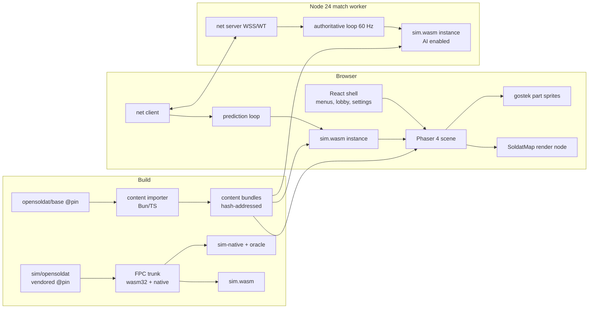

# soldat-web — Specification

Status: draft v1, 2026-10-15. Codename only; see §9.2 for public naming.
Evidence: `docs/research/*.md` (six research reports; each claim there carries a source-line or URL citation). The originating chat is `[raw planning conversation omitted]`.

## 0. Decision log

| # | Decision | Source |
|---|---|---|
| D1 | Simulation core = **original OpenSoldat Pascal mechanics, extracted and compiled to WebAssembly**, hosted from TypeScript in both browser and server. No hand-port to TS. | User, after prior-art findings |
| D2 | Fidelity baseline = **OpenSoldat 1.8 source as-is**, pinned to `opensoldat@bf43a43bdd7a069e02c906768807f66e621b2888`. Classic 1.7.1.1 is informational only. | User |
| D3 | **Strict server authority**: clients send inputs only; server owns movement, projectiles, hits, ammo, health, pickups, score. Clients predict locally. | User |
| D4 | Launch scope = **DM + CTF, all stock weapons, original waypoint bots**, vanilla rules, humans and bots. | User |
| D5 | Renderer = **Phaser 4.2.1 + custom Soldat map render node**, conditional on spike gate G0.4; fallback PixiJS v8 with the same shader. | Default (chat preference + RenderingPhaser) |
| D6 | Transport = **WSS first** (binary, versioned); **WebTransport datagrams** evaluated before any WebRTC work. Custom thin protocol, not Colyseus (sim state is an opaque WASM blob that Colyseus Schema cannot own). | Default (NetcodeTransport) |
| D7 | Server runtime **Node 24 LTS**; one WASM instance per match, one match per `worker_thread`. Bun for tooling/build only. | Default |
| D8 | Content = **opensoldat/base pinned at `5b6e5bef23f5c0d58fb1d4d887b9b94ebcf799b4`** (CC BY 4.0), curated and hash-manifested. No files from the classic 1.7.1.1 installer are shipped. | Default (LicensingProvenance) |
| D9 | Platforms: desktop, keyboard + mouse; current and previous major of Chrome/Edge, Firefox, Safari ≥ 26.4. Mobile/touch out of scope. | Default |
| D10 | Independent public product name/logo; "Soldat" used only descriptively with non-endorsement disclaimer. | Default (LicensingProvenance) |

Defaults D5–D10 are reversible; changing them changes the plan, not the architecture.

## 1. Goal

A browser-native, online multiplayer game that **plays identically to OpenSoldat 1.8** for movement, weapons, collision and bots, renders original Soldat maps and soldiers faithfully, and runs on modern authoritative-server netcode.

### 1.1 Non-goals (launch)

- Network compatibility with existing Soldat/OpenSoldat servers or clients.
- Game modes other than DM and CTF (PM, TM, Rambo, INF, HTF), realistic/survival/bonus modes, bullet time.
- PascalScript server scripts, Kraken anti-cheat, custom HUD (`.sif`/`.sint`) layouts, pre-1.7.1 weapon mods, pre-v11 `.pms`/`.pmp` maps.
- In-game music (OpenSoldat 1.8 does not reference the three tracker modules).
- Accounts, rankings, persistence (no PostgreSQL at launch), public user map hosting.
- Mobile/touch controls, WebGPU.

## 2. Assumptions register

What the original chat assumed, and what research established. "Consequence" is binding on this spec.

| Chat assumption | Verdict | Consequence |
|---|---|---|
| Nobody has done a browser Soldat; we must port | **Refuted.** `humanova/soldat-web` (MIT, Sep 2026) runs the original Pascal client as WASM. It is a client + UDP relay, no sim API, no authoritative server. | D1. Reuse its FPC wasm32 toolchain recipe and VFS ideas with attribution; do not fork its client. |
| A TS port of the sim is the natural path | **Weakened.** ~17k LOC mechanics surface; 503 `{$IFDEF SERVER}` branches in mechanics units; f32/ties-even rounding, RNG order, `Math.sin` engine variance all threaten fidelity. | D1. WASM preserves arithmetic, and the same binary gives cross-engine determinism. |
| Source code is the spec for "original feel" | **Nuanced.** Source is unfinished 1.8, not 1.7.1.1; later commits changed mechanics. | D2: pin 1.8 commit; source is truth by definition. |
| Fixed-rate sim independent of rendering | **Confirmed.** 60 Hz, `TimeStep=1`, forces in tick units. | Sim never sees wall-clock dt. |
| Character animation is presentation | **Refuted.** POA poses drive hit circles, muzzle, grenade release, flag anchor. Server needs POA/PO. | Pose evaluation lives in the sim; renderer only interpolates sim skeletons. |
| Maps = geometry + textures | **Refuted.** 26 polytypes, stateful background transitions, bounciness encoded in raw normal magnitude, sectors, colliders, waypoints, `StartJet` conversion. | Sim parses raw `.pms` bytes itself; nothing normalizes normals. |
| Phaser renders original maps out of the box | **Refuted.** Phaser 4.2 `Mesh2D` has no per-vertex RGBA; tint math differs from Soldat's vertex-premultiplied alpha; Phaser refuses NPOT `REPEAT` (desert terrain is 1536×512). | D5: custom render node + shader; spike gate G0.4. |
| Rendering is 640×480 | **Nuanced.** Logical height 480, width = round(clamp(aspect,1.25,1.78)·480), exp-zoom camera with 0.14 follow and aim offset. | §5.3 camera requirements. |
| Server decides damage (original did client hits) | **Mostly source-aligned.** Original server computes damage but **trusts client position/velocity** and never corrects own position. | D3 is a deliberate feel change; reconciliation must be tuned and measured (§6.4). |
| Original send rate ≈ tick rate | **Refuted.** 60 Hz sim, ~12–15 Hz client movement sends, slower snapshots. | New protocol: 60 Hz inputs, 30 Hz snapshots (initial). |
| WebSockets now, WebRTC later | **Updated.** Safari 26.4 shipped WebTransport (Mar 2026). | D6. |
| Original assets are CC BY / MIT | **Nuanced.** Base assets CC BY 4.0 (since Jul 2020); font is SIL OFL 1.1; `Vector.pas` is MPL 1.1/LGPL; Kraken SDK is revocable-permission only; classic installer is shareware-licensed. | §9 content/legal policy. |
| Base assets = classic assets | **Partly.** All 97 classic maps byte-identical; some sprites/scenery/kits changed; 1.7.x art is already HD. | D2 makes base + OpenSoldat rendering the visual truth. |
| `.smod` is a custom format | **Refuted.** Standard ZIP; PhysFS mount precedence matters. | Importer reads ZIP; mount rules ported. |
| Images load directly | **Nuanced.** 2,070 PNG-override lookups, 12 case-only matches, 16 extension/signature mismatches, exact green key (0,255,0,255) on single-frame images only, 921/1,066 NPOT, ~375 MiB decoded total. | §5.2 importer rules; per-map lazy loading. |
| Sounds need conversion | **Narrow.** 163 PCM WAV + 1 MS-ADPCM (`jump.wav`). | Ship PCM WAV; convert `jump.wav`. |
| Bots needed for early testing | **Refuted.** Scripted command fixtures test physics better. | Bots arrive after combat (plan Phase 5). |

## 3. Pinned baselines

| Item | Pin |
|---|---|
| OpenSoldat source | `bf43a43bdd7a069e02c906768807f66e621b2888` (develop, 2026-09-26) |
| Base content | `5b6e5bef23f5c0d58fb1d4d887b9b94ebcf799b4` |
| FPC (wasm32-wasip1 and native) | trunk `bcd728860dcd953cb6f3bbda788eab07b0d16c85` (humanova recipe); same compiler for oracle, native-extracted and wasm builds |
| Phaser | 4.2.1 |
| Node | 24 LTS |
| Weapons | `base/server/configs/weapons.ini` (Version=1.7.1 units) |

## 4. Architecture



### 4.1 Simulation core (`sim.wasm`)

**Source.** `opensoldat/opensoldat` at the pinned commit, vendored into `sim/opensoldat` (KrakenSDK excluded) by the repository's first commit, so every change is a reviewable diff against that commit. Units in scope: `Vector, Calc, Parts, Anims, PolyMap, MapFile, Waypoints, Weapons, SharedConfig (weapon INI subset), Game (state subset), Sprites, Control, Bullets, Things, AI, Sparks`.

**Role.** Compiled once with a single role-neutral define (`SIM`). Gameplay semantics follow the **server-role** branches. Every client-role branch that changes gameplay (self-bink, recoil-to-cursor, client jet-fuel 1→0 adjustment, client-only bullet history collision, push-tick scheduling) is recorded in `docs/role-divergence-ledger.md` with an explicit decision. Network, audio, menu, SDL, script and Steam calls are removed or replaced by event emission.

**Platform shims.** PhysFS replaced by an in-memory VFS populated by the host (`sim_vfs_put`). No C objects, FreeType, SDL or OpenAL in the sim. [INFERENCE: this may remove the need for humanova's Clang/linker patch; verify in G0.2.]

**ABI (C calling convention, numeric args, linear-memory buffers).** Initial contract; refine in Phase 1, version every layout.

| Export | Purpose |
|---|---|
| `sim_version() → u32` | ABI + state-layout version |
| `sim_alloc(n)` / `sim_free(p)` | host buffers |
| `sim_vfs_put(path, len, data, len)` | provide content files before init |
| `sim_init(rules, len, seed_lo, seed_hi, flags)` | flags: `AI_ENABLED`, `RNG_POLICY` |
| `sim_load_map(name, len) → status` | parse `.pms` via original `MapFile`/`PolyMap` |
| `sim_command(tick, ptr, len)` | reliable commands: join, leave, team, weapon choice, respawn, kick |
| `sim_set_input(slot, tick, ptr)` | per-tick input (below) |
| `sim_step(flags) → tick` | advance one 60 Hz tick; flag `REPLAY` suppresses FX/sound events |
| `sim_events(out, cap) → len` | drain ordered gameplay + presentation events |
| `sim_render_view() → ptr` | fixed-layout struct readable as typed arrays: per sprite current+previous 24 skeleton points, anim IDs/frames, aim, weapon, flags; bullets; things |
| `sim_save_state(out, cap) → len` / `sim_load_state(p, len)` | versioned explicit serialization of all gameplay globals incl. RNG state |
| `sim_hash_state() → u64` | gameplay state hash |
| `fx_step()` / `fx_render_view() → ptr` | cosmetic sparks/weather subsystem: own RNG, excluded from save/load/hash, never stepped during replay |

**Input record** mirrors the original `TControl` (`Sprites.pas:79-84`): booleans `Left, Right, Up, Down, Fire, Jetpack, ThrowNade, ChangeWeapon, ThrowWeapon, Reload, Prone, FlagThrow` (packed to u16), `MouseAimX, MouseAimY, MouseDist` (i16, world-space, as the original), plus the press-order bits needed for the original first-key/conflicting-key resolution (`Control.pas:64-70,175-180`).

**RNG.** `RNG_POLICY=original` keeps FPC `Random` with global consumption order — used only for T1 oracle comparison. `RNG_POLICY=keyed` (product) derives spread/cluster/damage-poly randomness from `hash(match_seed, entity, counter)` so predicted shots match the server regardless of other players' consumption; AI uses its own stream. Both are ledger entries.

**Instancing.** All sim state is Pascal globals ⇒ exactly one match per WASM instance. Never share an instance across matches.

### 4.2 Content pipeline (`packages/content`)

- Input: pinned base checkout (and, later, user-supplied local `.smod`/`.pms`).
- TS readers for PMS v11, POA, PO, `mod.ini`, `weapons.ini`, ZIP; byte layouts per `docs/research/FileFormats.md` §1. Strict bounds/finite checks; accept and preserve trailing bytes.
- Path resolution exactly as `GameRendering.pas:337-354`: lowercase + `/` canonical ID, PNG preferred over requested extension, case-insensitive match; image type from signature, not extension.
- Images: exact green key (0,255,0,255) only on single-frame non-terrain images; derivatives stored straight-alpha and premultiplied exactly once at GPU upload; NPOT preserved; per-asset scale from `mod.ini` `[SCALE]` (default 4.5); `GostekGraphics.inc` 131-entry table (IDs 0–130; the file is 138 lines) exported as data with `[GOSTEK]` center overrides.
- Audio: PCM WAV passthrough; `jump.wav` → PCM.
- Output: immutable hash-addressed objects + per-map manifest (`map hash, terrain, scenery, sim content set`) + a **sim content set** (raw PMS, POA, PO, weapons.ini) with one combined hash that client and server must match before join.
- Provenance per file: source repo/commit/path, SHA-256, license id, credit, transformations.
- Missing active dependencies are reported and rendered with the original fallback (`default` texture) plus a visible warning.

### 4.3 Client (`packages/client`)

- Vite + React 19 shell for menus, server list, settings, key binding, credits/licenses. React never touches per-frame state.
- Phaser 4.2.1 scene owns the canvas, input sampling, audio (Web Audio via Phaser Sound) and draw.
- `SoldatMap` render node: vertex `(x,y,u,v,RGBA8)` 20 bytes, static buffers, vertex shader `color = vec4(rgb*a, a)`, fragment `texture(PMA) * color`, blend `ONE, ONE_MINUS_SRC_ALPHA`, terrain `REPEAT` incl. NPOT (WebGL2 native or repeat-aware shader), original polygon order within layer, consecutive same-texture runs batched.
- Draw order exactly `GameRendering.pas:1004-1086`: gradient (world-anchored) → background edges → background polys → scenery L0 → bullets → soldiers → things → sparks → scenery L1 → thing polys → foreground edges → foreground polys → scenery L2 → HUD.
- Smooth edges generated as in `MapGraphics.pas:460-492,617-671`.
- Gostek: one sprite per visible part from the exported table: position = skeleton p1, rotation = atan2(p2−p1), pivot, flex stretch `min(1.5, |p2−p1|/Flex)`, flip rule per part, team texture variant, per-channel colors, +1 Y offset.
- Render interpolation: lerp previous/current sim skeletons by accumulator fraction; never mutate sim state.
- Camera: logical height 480; width from clamped aspect; zoom `exp(z)` eased by ¼ per tick, snap 0.01; follow 0.14 + aim offset per `UpdateFrame.pas:351-400`; mouse→world round-trips exactly.
- Filtering: nearest/linear and mipmaps configurable per class as original; no global pixel-art switch; no additive blending.

### 4.4 Server and netcode (`packages/server`, `packages/protocol`)

- Match worker: monotonic accumulator, fixed 1/60 s steps, max 4 catch-up ticks per wake, overload recorded; never variable dt.
- Messages: explicit versioned little-endian binary codec. Asset delivery via CDN, never over the game socket.
- Client→server: input frame every tick `{seq, tick, input}` + previous 2 frames (redundancy). Server buffers per player, bounded lead (≤2 ticks future), repeats last input on gap, rejects stale one-shot actions.
- Server→client: snapshot 30 Hz `{server tick, last consumed input seq, state}`; state = `sim_save_state` blob **delta-encoded against the last acknowledged baseline**; reliable events (kills, captures, pickups, chat, score) with IDs, exactly-once at the application layer.
- Prediction: on snapshot, `sim_load_state(server)`, replay unacknowledged local inputs (remote/bot inputs held at last known) with `REPLAY`; ring of 128 frames; overflow ⇒ full resync.
- Remote soldiers render from interpolated authoritative snapshots (start 50 ms, adapt 33–100 ms); local soldier renders from prediction; corrections smoothed visually only.
- Lag compensation for projectiles: on an admissible delayed fire command, derive muzzle/aim/cooldown from historical shooter state and step the projectile through historical target states to now; history 500 ms, catch-up cap 200 ms. Grenades/rockets/melee get explicit per-style policy. The cap limits compensation, not admission: movement inputs are accepted regardless of the client's view age, and fire/grenade commands whose view is older than the cap execute at present time without rewind (counted as a metric), never dropped.
- Client prediction lead is adaptive (smoothed one-way delay + jitter margin + 1–2 ticks, bounded by the 128-frame ring), not a fixed cap.
- Validation: finite/range checks, input rate cap, sequence/replay rejection; client never sends position, velocity, hits or damage.
- Transport interface: two channels `reliableControl` and `latestState`. WSS implements both on one socket. WebTransport adapter maps `latestState` to datagrams. Transport chosen once at admission; no mid-match switching.

### 4.5 Bots

Original `AI.pas` runs inside the server's sim instance (`AI_ENABLED`), using PMS waypoints and its own RNG stream. Client instances run with AI disabled; bot inputs reach clients through snapshots like remote humans. Maps with zero waypoints are flagged bot-incapable in the manifest.

## 5. Functional requirements

### 5.1 Simulation
- **R-SIM-1** 60 Hz fixed tick; positions/forces in original tick units; bullet time disabled.
- **R-SIM-2** All movement states: run, air control, jump/sidejump (frame-gated), backflip, roll, crouch, prone, get-up, jets with `floor(119·StartJet/100)` capacity and grounded/airborne refill.
- **R-SIM-3** All 26 polytypes with source semantics, including background transitions, team/flag filters, bouncy (raw normal magnitude), deadly/hurts/lava/regenerate/explodes.
- **R-SIM-4** All 23 stock weapon definitions and 14 bullet styles, INI overrides over compiled defaults, grenade charge/release frames 15–36, cluster fragments, ricochet, arrows, flamer, LAW posture gates, melee.
- **R-SIM-5** Things: flags, kits, dropped weapons, parachute, stationary gun; pickup rules; flag throw/return (1500 ticks) /capture.
- **R-SIM-6** Death, ragdoll (skeleton Verlet), respawn via spawnpoints.
- **R-SIM-7** DM and CTF rules, scoring, match end, map rotation.
- **R-SIM-8** Bots per §4.5.
- **R-SIM-9** Up to 32 player slots (original `MAX_PLAYERS`); launch acceptance at 16.

### 5.2 Content
- **R-CON-1** Import all 99 base maps with zero parse failures; 97 classic maps with zero missing active assets; Aftermath/Amnesia import with explicit fallback warnings.
- **R-CON-2** All 51 POA, 6 PO, gostek table, weapons.ini, mod.ini consumed from pinned base.
- **R-CON-3** Deterministic output: same inputs ⇒ byte-identical bundle hashes.
- **R-CON-4** Per-map lazy loading; global core (gostek, weapons, sparks, interface, SFX) loaded once.
- **R-CON-5** Local-only import of a user `.pms`/`.smod` for offline viewing (no upload). Untrusted archives: bounded entries, bytes, dimensions, no traversal, case-collision rejection.

### 5.3 Client
- **R-CLI-1** Render per §4.3 at ≥144 Hz on the reference desktop (to be named in G0.4) and ≥60 Hz on the reference laptop.
- **R-CLI-2** Original key defaults; rebinding; mouse aim.
- **R-CLI-3** HUD: health, ammo, jet, grenades, vest, weapon, reload, team/score, ping, kill feed, chat, scoreboard. Default interface only.
- **R-CLI-4** Sound: positional SFX from sim events with original attenuation semantics; explicit audio-unlock gesture.
- **R-CLI-5** Offline practice mode: local sim instance with bots, no server.
- **R-CLI-6** Credits & Licenses screen reachable from main menu and in-game About (§9).

### 5.4 Server/ops
- **R-SRV-1** Server list, join by link, nickname only.
- **R-SRV-2** Regional Linux VMs, WSS on TCP/443; UDP/443 reserved for WebTransport evaluation.
- **R-SRV-3** Metrics: tick lateness, step/encode time, GC/event-loop delay, per-client RTT/loss, correction magnitudes, snapshot age, bytes/s.

## 6. Acceptance criteria

### 6.1 Determinism tiers (sim)
- **T1 refactor equivalence** — `sim-native` (extracted, `RNG_POLICY=original`, AI off) vs `oracle` (pinned upstream + trace/injection harness only, server role), same compiler/host: **bit-identical f32 state every tick** across the movement and combat corpora (§6.2). Every deviation must map to a ledger entry or fails.
- **T2 target equivalence** — `sim.wasm` vs `sim-native`, same corpus: **identical tick for every discrete event** (grounding, collision branch, shot, hit, death, pickup, capture) and numeric max abs error ≤ 1e-4 world units (≤ 300 ticks) / ≤ 1e-3 (10,000 ticks). Target bit-exact; any mismatch is root-caused (likely RTL transcendental differences). Thresholds are initial and tighten as evidence allows.
- **T3 cross-runtime** — the same `sim.wasm` in Node 24, Chrome, Firefox, Safari: **identical `sim_hash_state` at every tick** over all corpora, including `save/load` round-trips mid-run. Hard requirement; prediction depends on it.

### 6.2 Fixture corpora
- Movement: mirrored flat/slope runs; acute/overlapping edges; key press orders; tap/hold jump; sidejumps/backflips; roll→crouch/prone/get-up; jets at capacity 0/1/N; refill parity; background entry/exit; every team/flag polytype; bouncy.
- Combat: standing/crouch/prone/moving targets; all 7 hit circles; thin-wall high-speed; ricochet; collider/thing/player ordering; damage decay; reload interruption; shotgun/Eagles seeding; grenade release at frames 14/15/23/24/36; cluster fragments; self-boost; weapon drops; flag throw/capture/return.
- Each fixture: map hash, content-set hash, seed, scripted per-tick inputs, ≥ 300 ticks; long runs 10,000 ticks.

### 6.3 Rendering
- Screenshot comparisons vs native OpenSoldat client at the same camera/zoom/resolution/filtering, dither off: Airpirates (vertex alpha), Aero + DesertWind (NPOT 1536×512 repeat), Jungle (case-only names), one heavy-scenery map, synthetic RGBA triangle with UVs beyond ±27 (corpus max is ±26.3). Gostek: run L/R, aim sweep, crouch, prone, jet, reload, both teams, dead pose. Pass threshold: ≤ 1% of pixels differ by > 8/255 in any channel (G0.4 measured worst 0.015%; regressions above 0.1% must be explained). Prop and edge pivots are absolute rotation centres (`GfxSpriteVertices`), gostek pivots are normalized (see `docs/gates/G0.4.md`).
- Performance: 903-triangle map + 500 props + 32 soldiers + 512 sparks at targets in R-CLI-1; context loss/restore and React remount recover without leaks.

### 6.4 Network (tc/netem on real packets)
- Matrix: RTT 0/20/50/100/150/250 ms (incl. asymmetric 10+90); jitter 0/5/15/30 ms; loss 0/0.1/1/3/5 % plus bursts and 100/250/500 ms outages; bandwidth caps 128/512 kbps up.
- LAN: local movement visible on the next rendered frame; zero persistent correction drift.
- 100 ms RTT + 15 ms jitter + 1 % loss: 60 Hz sustained at 16 players; reliable events exactly-once; no stuck fire/jet; correction p95 < 2 world units and > 10-unit corrections < 1/min/player on ordinary movement (initial targets).
- 250 ms / 5 % bursty: degraded but invariant-safe (no extra ammo, speedhack, duplicate kill/pickup), clean resync, no leak.
- Server: sim+encode p99 < 8 ms, tick lateness p99 < 4 ms at 16 players; 30-min soak and 2-h memory soak stable.
- Security: rejects NaN/inf, malformed packets, sequence jumps, future/stale fire timestamps, input flooding; a stalled client gains no simulation time.

### 6.5 Content
- 99/99 maps import; 97 render with no missing active asset; all 164 SFX decode in all target browsers with duration within 1 ms of source.

## 7. Repository layout

```
soldat-web/
  reference/            pinned upstream clones (read-only, never shipped)
  sim/
    opensoldat/         vendored upstream @pin; all sim edits are diffs against the vendor commit
    build/              Dockerfile (pinned FPC trunk), build scripts → sim.wasm, sim-native
  tools/oracle/         upstream + harness patch, trace capture CLI
  packages/
    sim-host/           TS bindings for sim.wasm (Node + browser), typed views, trace diff
    content/            importer CLI → dist/content/
    protocol/           binary codecs, transport interface
    client/             Vite + React + Phaser
    server/             Node 24 match server
  tests/fixtures/       input scripts, golden traces, screenshots
  docs/                 research/, role-divergence-ledger.md, licenses/
```
Bun workspaces for build/test tooling; server runs on Node 24.

## 8. Risks

| Sev | Risk | Mitigation |
|---|---|---|
| High | Extraction drags in net/UI/audio graph | Replace with event emission; T1 bit-exact gate catches behaviour drift per unit |
| High | FPC trunk + wasm toolchain breaks or rots | Pinned commit in Docker; sim needs no C; contact humanova; upstream small fixes |
| High | Server authority makes jets/knockback feel corrected | Full-state rollback, smoothing, correction metrics in §6.4; tune snapshot/interp before launch |
| High | Phaser custom node intrusive or slow | G0.4 gate; Pixi v8 fallback with same shader and data |
| High | `save_state` misses hidden state ⇒ prediction desync | T3 save/load round-trip tests every tick on corpora; hash compares server vs client in debug builds |
| Med | Full-state snapshots too large at 32 players | Delta vs acked baseline; measure; cosmetic state excluded |
| Med | Native oracle won't build on arm64 macOS | Build in Linux container (amd64/arm64) |
| Med | License contamination (Vector.pas MPL, Kraken, classic files) | §9 policy; Kraken excluded from fork; Vector.pas kept with MPL 1.1 notice and source availability |
| Med | Global Pascal state limits rooms per process | One instance per match per worker; measure memory per instance |

## 9. Content, licensing, branding

1. Ship only files derived from pinned `opensoldat/base` (CC BY 4.0) plus the unmodified Play TTF (SIL OFL 1.1). Classic 1.7.1.1 installer is a local reference fixture only.
2. Code: project code MIT; retain OpenSoldat MIT notice in the sim fork and served third-party notices; `Vector.pas` stays under MPL 1.1 with its header and published source; Kraken SDK, PascalScript, dglOpenGL and SDL bindings are not built into `sim.wasm`. humanova/soldat-web (MIT) attribution for reused toolchain scripts.
3. Credits & Licenses screen: Michał Marcinkowski / Transhuman Design; OpenSoldat contributors; base `Credits.md` names; known map authors from the 1.7.1.1 manual; BSG for the modules if ever shipped; CC BY 4.0 link + pinned base commit; list of browser transformations; Play OFL notice; non-endorsement disclaimer.
4. Naming: codename `soldat-web` internal only. Public title/logo are original and cleared before launch. Allowed descriptive phrasing: "Unofficial browser game using open-licensed Soldat/OpenSoldat content", "Plays Soldat .pms maps". No "Soldat" in product name or logo without written THD/MM permission.
5. User content is local-only at launch; public hosting requires a separate rights/takedown design.

## 10. Open items (do not block Phase 0)

- Reference hardware for R-CLI-1 (named in G0.4).
- Public product name.
- Regions and monthly hosting budget (needed before Phase 7).
- Bug-compatibility exceptions: default is "reproduce", including `TeamCollides` blue/yellow anomaly (`Sprites.pas:434-438`); any fix is a ledger entry.
